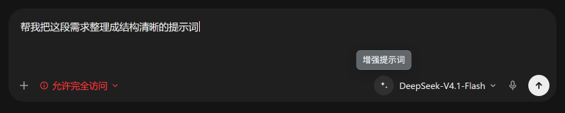
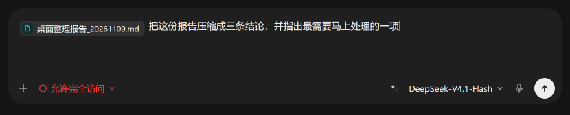
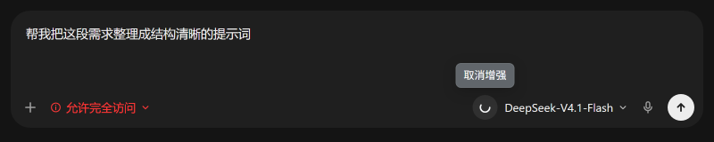
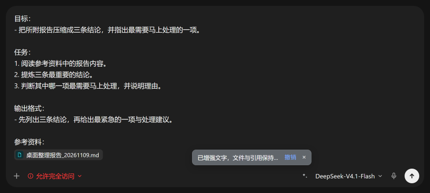

# Enhance prompt · dsh-enhance-prompt

A DeepSeek Harness (DSH) Web GUI plugin. It adds a ✨ icon button to the composer toolbar, **immediately to the left of the model selector**. One click rewrites your draft into a **clear, sectioned prompt**.

**Only your typed text is enhanced; uploaded images, files and inline references are preserved** — nothing disappears or turns into a plain-text path.

> Version 1.1.0 · Requires DSH 0.2.2-rc.2+ · No third-party dependencies, no build step

中文说明：[README.md](README.md)

---

## Screenshots

> These are **mockups** drawn at the 1.1.0 layout, colors and copy — not live screenshots.

The button sits to the left of the model selector; hover shows the "Enhance prompt" tooltip:



With a file attached, only the text is rewritten — the file stays a clickable chip:



While the request runs the icon becomes a spinner; a second click after 400 ms cancels it:



When it finishes the draft becomes a sectioned prompt, the file chip moves under "References", and the note offers Undo:



---

## What it does

Before (a short draft with an attached file):

```
[[DSH_REF_0]] 帮我总结这份文档，并说明下一步该做什么
```

After (rewritten; the file is still a clickable chip):

```
目标：
- 总结所附文档的内容，并说明下一步该做什么。

任务：
1. 阅读并理解参考资料中的文档。
2. 概括文档的主要内容与关键要点。
3. 基于文档内容，说明接下来应当采取的行动。

输出格式：
- 先给出文档总结，再给出下一步行动建议。

参考资料：
[[DSH_REF_0]]   ← still a file chip, not text
```

## Features

- ✨ Rewrites the draft into a **sectioned prompt**: plain-text section labels (`Goal:`), lists and blank lines; **no `#` or bold** (the Host strips them even if the model disobeys).
- 📎 **Files, images and `@references` are preserved**: inline references round-trip as opaque `[[DSH_REF_n]]` markers and are rebuilt as their original chips; image/file attachments live outside the text and are re-checked and **restored if a draft swap drops them**.
- ↩️ **Undo** from the status note restores the exact original draft, files and references included.
- ⏳ Spinner while running; click again to **cancel**; client and Host timeouts.
- 🛡️ Empty draft, file-only draft, command mode, unsupported draft shape, non-editable input, model errors, timeouts, over-long drafts and a dropped marker each report a specific message and never corrupt the draft; a draft you edit mid-request is never overwritten.
- 🌗 Follows light/dark theme and the active locale; tooltip only on hover/keyboard focus.

## Performance and implementation

- **Language-aware prompt**: sends only the Chinese or English system prompt matching the draft, roughly halving system tokens for latency and cost.
- **One request, no history**: a single standalone model call; nothing is written to the session log and no Agent is activated.
- **Lean client**: a stable selector avoids resubscribing; styles and icons are built once; the button re-renders only on input-phase changes.
- **Robust pipeline**: auth fence → method/type checks → bounded body read → JSON/length checks → model call → finish/marker validation → output normalization.

## Install

**Option A (easiest)**: DSH → **Plugins** → **Add plugin** → choose the unzipped `enhance-prompt` folder → refresh the page.

**Option B**: `plugin_manager install_bundle target=<absolute path>` (an `application: applied` result means it is live).

**Option C (not recommended)**: add `"dsh-enhance-prompt": "link:<absolute path>"` to `dependencies` in `$DSH_PROFILE_DIR/package.json` and add the package to `dsh.profile.bundles`, then restart DSH.

> Button missing: refresh once; if still missing, restart DSH or toggle the plugin off/on in Plugins.

## Configuration (optional)

Uses the deployment default model by default. To tune it, override by row id in the profile's `cordis.patch.yml` (see [`examples/config.example.yml`](examples/config.example.yml)):

```yaml
- id: enhance-prompt
  name: dsh-enhance-prompt
  config:
    structured: true          # true = sectioned; false = single paragraph
    reasoningEffort: off      # off/low/high/max; off saves tokens
    # provider / model        # optionally point enhancement at a cheaper model
    maxInputChars: 8000
    maxOutputTokens: 2048
    timeoutMs: 75000
    # system: 'custom system prompt'
```

| Field | Default | Meaning |
|---|---|---|
| `structured` | `true` | Sectioned output |
| `provider` / `model` | empty (default model) | Model route for enhancement |
| `reasoningEffort` | inherited | `off`/`low` recommended |
| `maxInputChars` | `8000` | Draft character cap |
| `maxOutputTokens` | `2048` | Output token cap |
| `timeoutMs` | `75000` | Host-side timeout |
| `system` | built-in | Fully override the system prompt |

## How it works

- **Client**: registers a button in `conversation.input.right` (left of the model selector), reads `useInput()` draft/references/attachments and writes back via `inputActions.setDraft()`; within two paints it diffs and re-adds any dropped attachment ids via `addAttachments`.
- **Transport**: `POST /__local/enhance-prompt`, fenced by DSH's `connection.requestRejection()`.
- **Host**: calls the model with `ctx.llm.stream()`; each file/reference becomes an opaque `[[DSH_REF_n]]` marker the model must keep; the client rebuilds a semantic draft (`text + references`).

## Known limitations

- Command mode (draft starting with `/command`) is not supported yet.
- Inline **quote** nodes degrade to equivalent plain text (text preserved).
- Writeback relies on `setDraft` accepting a semantic draft object (works at runtime; re-verify after DSH upgrades).
- DSH-only (requires `webServer`, `connection`, `llm`, `agentDefaultModel`).

## License

MIT — see [LICENSE](LICENSE). Keep the license and attribution when redistributing.
