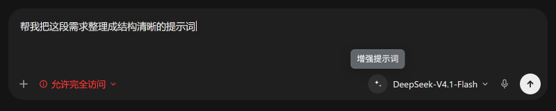
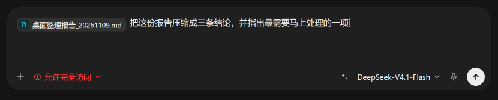
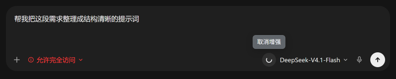
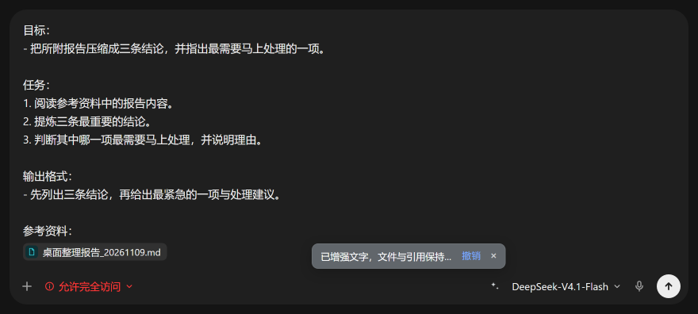

# 增强提示词 · dsh-enhance-prompt

一个 DeepSeek Harness（DSH）Web GUI 插件：在输入框工具栏、**模型选择按钮左侧**加一个 ✨ 图标按钮，点一下就能把当前草稿改写成**结构清晰、分段易读**的提示词。

**你手打的文字被增强；上传的图片、文件和内联引用都会原样保留**，不会消失，也不会变成纯文字路径。

> 版本 1.1.0 · 需要 DSH 0.2.2-rc.2+ · 无第三方依赖、无需构建

English: [README.en.md](README.en.md)

---

## 界面预览

> 以下为按 1.1.0 实际界面尺寸、配色与文案制作的**模拟图**（非真机截图）。

按钮位于模型选择按钮左侧，悬停显示「增强提示词」提示：



草稿里放入文件时，增强只改写文字，文件仍然是可点击的芯片：



请求进行中按钮变成转圈，再点一次（400ms 之后）可取消：



完成后草稿被替换为分段提示词，文件芯片留在「参考资料」里，提示条上有「撤销」：



---

## 效果

点 ✨ 前（随便写一句，带一个文件）：

```
[[DSH_REF_0]] 帮我总结这份文档，并说明下一步该做什么
```

点 ✨ 后（自动改写；文件仍是可点击的芯片）：

```
目标：
- 总结所附文档的内容，并说明下一步该做什么。

任务：
1. 阅读并理解参考资料中的文档。
2. 概括文档的主要内容与关键要点。
3. 基于文档内容，说明接下来应当采取的行动。

输出格式：
- 先给出文档总结，再给出下一步行动建议。

参考资料：
[[DSH_REF_0]]   ← 这里仍是文件芯片，不是文本
```

## 功能

- ✨ 一键把草稿改写为**分段结构化**提示词：普通文字小节标题（`目标：`）+ 列表 + 空行；**不使用 `#` 或加粗**（即使模型违规，服务端也会清理）。
- 📎 **文件 / 图片 / `@引用` 保留**：
  - 内联引用以不透明标记 `[[DSH_REF_n]]` 随请求往返，写回时按标记重建为**原芯片**；
  - 图片与文件属于输入框的附件（不在文字里），写回后会自动校验，**丢失的附件会被补回**；
  - 全程既不会把文件变成文字，也不会让图片消失。
- ↩️ **可撤销**：结果提示条里点「撤销」可恢复原草稿（含文件与引用）。
- ⏳ 请求中有加载动画，**再次点击可取消**；客户端与 Host 双重超时。
- 🛡️ 空草稿、只有文件、命令模式、草稿结构异常、输入状态不可编辑、模型报错、超时、草稿过长、模型丢标记，都给出**具体提示**且不破坏原草稿；请求期间你改了草稿也不会被覆盖。
- 🌗 跟随明暗主题；中英文界面自适应；只在悬停/键盘聚焦时显示提示气泡。

## 性能与实现要点

- **语言自适应提示词**：按草稿语言只发送中文或英文的单语系统提示（约省一半 system token），降低延迟与费用。
- **一次请求、无历史**：增强只发一次独立模型请求，不携带会话历史、不写会话记录、不触发 Agent。
- **轻量前端**：稳定选择器避免重复订阅；样式与图标常量只构建一次；按钮仅在输入阶段变化时重渲染。
- **健壮管线**：认证围栏 → 方法/类型校验 → 有界读体 → JSON 校验 → 长度校验 → 调模型 → finish/marker 校验 → 归一化输出。

## 安装

**方式 A（推荐）**：DSH → **Plugins** → **Add plugin** → 选择解压后的 `enhance-prompt` 文件夹 → 刷新页面。

**方式 B**：`plugin_manager install_bundle target=<本文件夹绝对路径>`（返回 `application: applied` 即生效）。

**方式 C（不推荐）**：在 `$DSH_PROFILE_DIR/package.json` 的 `dependencies` 加 `"dsh-enhance-prompt": "link:<绝对路径>"`，并把包名加入 `dsh.profile.bundles`，重启 DSH。

> 按钮没出现：先刷新页面；仍没有就重启 DSH，或在 Plugins 里禁用/启用一次。

## 配置（可选）

默认使用部署的默认模型。需要调参时，在 profile 的 `cordis.patch.yml` 按 row id 覆盖（示例见 [`examples/config.example.yml`](examples/config.example.yml)）：

```yaml
- id: enhance-prompt
  name: dsh-enhance-prompt
  config:
    structured: true          # true=分段结构化；false=单段落式
    reasoningEffort: off      # off/low/high/max；改写任务用 off 更省
    # provider / model        # 可选：指定更便宜的模型跑增强
    maxInputChars: 8000
    maxOutputTokens: 2048
    timeoutMs: 75000
    # system: '自定义系统提示词'
```

| 字段 | 默认 | 说明 |
|---|---|---|
| `structured` | `true` | 是否输出分段结构 |
| `provider` / `model` | 空（用默认模型） | 增强用的模型路由 |
| `reasoningEffort` | 继承默认 | 建议 `off`/`low` |
| `maxInputChars` | `8000` | 草稿字符上限 |
| `maxOutputTokens` | `2048` | 输出 token 上限 |
| `timeoutMs` | `75000` | Host 端超时 |
| `system` | 内置 | 完全自定义系统提示词 |

## 工作原理

- **前端**：在 `conversation.input.right` 插槽注册按钮（正好在模型选择左侧）；读 `useInput()` 的草稿/引用/附件，写回用 `inputActions.setDraft()`；写回后 2 帧内对 `addAttachments` 做一次差集补回。
- **传输**：`POST /__local/enhance-prompt`，由 DSH `connection.requestRejection()` 做同源+登录校验。
- **后端**：`ctx.llm.stream()` 调默认模型；文件/引用在请求中以 `[[DSH_REF_n]]` 表示，模型不得改动标记；返回后重建语义草稿（`text + references`）。

## 已知限制

- 命令模式（草稿以 `/命令` 开头）暂不支持。
- 内联 **quote** 节点会退化为等价普通文本（文字不丢）。
- 写回依赖 `setDraft` 接受语义草稿对象（运行时可用，DSH 升级后建议复验）。
- 仅适用于 DSH 环境（依赖 `webServer` / `connection` / `llm` / `agentDefaultModel`）。

## 目录结构

```
enhance-prompt/
├── package.json            # 插件清单（dsh.bundle + dsh.client）
├── cordis.patch.yml        # 插入 Loader 的一行（row id: enhance-prompt）
├── index.js                # Host：HTTP 路由 + 调模型 + 校验/归一化
├── client.js               # 浏览器：按钮 UI + 草稿/引用/附件读写
├── locale/{zh,en}.json     # 插件标题/描述
├── icon.svg                # 插件图标
├── examples/config.example.yml
├── README.md / README.en.md
├── CHANGELOG.md
└── LICENSE
```

## 许可

MIT，见 [LICENSE](LICENSE)。转载请保留许可与来源说明。
